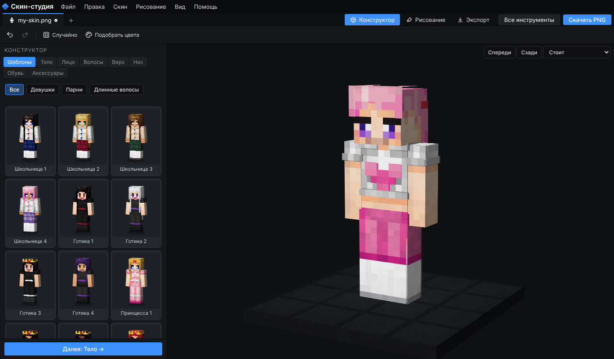
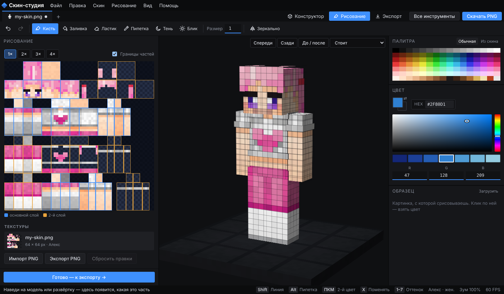

# Скин-студия — редактор скинов Minecraft

Редактор скинов прямо в браузере: собери персонажа из готовых деталей, дорисуй руками на 3D-модели и скачай PNG для Java и Bedrock. Работает без установки и без интернета — это один файл `index.html`.

**Открыть в браузере:** https://enotsbeye.github.io/skin-studio/

**Скачать программу для Windows:** [SkinStudio-Windows.zip](https://github.com/Enotsbeye/skin-studio/releases/latest/download/SkinStudio-Windows.zip) — один файл `SkinStudio.exe` (~3 МБ), своё окно, работает без интернета.



## Что умеет

**Конструктор**
- 100 готовых персонажей-шаблонов (25 образов × 4 палитры), фильтры «Девушки / Парни / Длинные волосы»
- клик по шаблону — персонаж сразу в нём, Ctrl+Z — вернуть как было
- «Случайно» собирает новый вариант на основе шаблона, поэтому детали сочетаются
- 33 причёски — от ёжика до волос до колен, рваная чёлка на втором слое, пробор, тени и блики со сдвигом оттенка
- лица, верх, низ, обувь, аксессуары, любые цвета в HEX
- объёмная одежда: подол, воротник, манжеты, пуговицы и обувь выпирают на втором слое, складки на поясе, локтях и коленях
- модели Стив (руки 4 px) и Алекс (3 px), фигура для мода Female Gender Mod

**Рисование**
- кисть прямо по 3D-модели или по развёртке, режим «Авто» сам выбирает видимый слой
- лестница оттенков (7 тонов выбранного цвета), два цвета: левая и правая кнопки мыши
- тень, блик, заливка, ластик, пипетка, зеркальная кисть, прямые линии, шум для текстуры, сетка из двух цветов
- слои рисования с прозрачностью, порядком и объединением
- «До / после», показ одной части тела, картинка-образец для срисовки и палитра из её цветов
- «Цвет и яркость»: сдвиг тона, насыщенности и яркости всего скина или одной части — отдельным слоем

**Скорость**
- 60 кадров даже на слабых ПК: свет без CSS-фильтров, у каждой грани своя маленькая картинка, перерисовывается только то, что изменилось

**Файлы**
- импорт PNG 64×64, старых 64×32 (левые рука и нога отражаются, как в игре) и HD-скинов
- если перетащить обычную картинку, она ляжет в «Образец», а не сломает скин
- экспорт PNG, проект `.json` со всеми слоями, 8 слотов в браузере, отмена Ctrl+Z



## Как поставить скин в игру

1. Нажми «Скачать PNG».
2. **Java Edition:** лаунчер Minecraft → «Скины» → «Новый скин» → выбери файл и ту же модель (Стив или Алекс), что в редакторе.
3. **Bedrock:** Гардероб → классический скин → «Импорт» → выбери файл.

Названия кнопок могут немного отличаться в разных версиях игры и лаунчера.

## Горячие клавиши

| Действие | Клавиша |
|---|---|
| Отменить / повторить | Ctrl+Z / Ctrl+Y |
| Кисть / заливка / ластик / пипетка | B / G / E / I (или Alt + клик) |
| Тень / блик | D / L |
| Рисовать вторым цветом | правая кнопка мыши |
| Поменять цвета местами | X |
| Оттенок из лестницы | 1–7 |
| Размер кисти | [ и ] |
| Зеркальная кисть | M |
| Показать одну часть тела | Q (навести курсор) |
| Скин до правок | держать C |
| Перекрасить цвет / выделение | R / S |
| Сетка из двух цветов | T |
| Прямая линия | Shift + клик |
| Приблизить развёртку | Ctrl + колёсико |

## Установка

**Программа для Windows 10/11**
1. Скачай `SkinStudio-Windows.zip` (ссылка выше) и распакуй: правой кнопкой → «Извлечь всё».
2. Запусти `SkinStudio.exe`.
3. Если появится синее окно «Система Windows защитила ваш компьютер» — «Подробнее» → «Выполнить в любом случае». Так Windows встречает любую программу без платной цифровой подписи.

Скины сохраняются через обычное окно «Сохранить как». Программа сама проверяет обновления при запуске и в «Помощь → Проверить обновления». Работа и настройки — в `%APPDATA%\SkinStudio.exe`. Не переименовывай `SkinStudio.exe`, иначе программа начнёт с чистого листа.

**Как приложение из браузера (Windows, Android, Chromebook)**
Открой сайт в Chrome или Edge → значок установки в адресной строке (или меню → «Установить приложение»). Появится ярлык, отдельное окно и работа без интернета.

**Собрать программу самому**
```bash
npm i -g @neutralinojs/neu
python3 desktop/build.py 1.0.0    # → desktop/dist/SkinStudio-Windows.zip
```
Сборка на [Neutralino.js](https://neutralino.js.org): маленький exe, который показывает редактор во встроенном в Windows движке WebView2.

## Запуск у себя

Скачай `index.html` и открой двойным кликом — сервер не нужен. Работа сохраняется в браузере автоматически.

Облачная галерея («Мои скины в облаке») работает только когда редактор открыт внутри claude.ai, поэтому на сайте её нет. Слоты, файлы проекта и автосохранение работают везде.

## Тесты

Автотесты открывают редактор в браузере и проверяют 100+ сценариев: рисование, слои, отмену, импорт, сохранение, тысячи отрисовок и сотни случайных действий подряд. Отдельно проверяются собранная программа (сохранение настоящих файлов на диск) и установка с сайта (офлайн-кэш).

```bash
pip install playwright
playwright install chromium
./tests/all.sh
```

Свой Chrome вместо Chromium: `CHROME=/путь/к/chrome ./tests/all.sh`.
